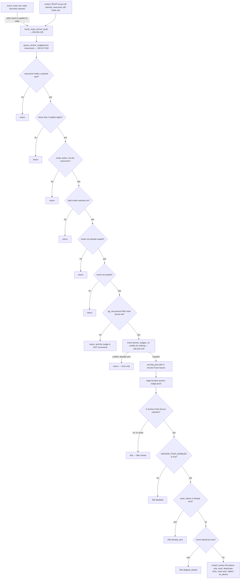

# S5b — Brought By §2b: the anchor push

Branch: `feat/v0107-brought-by`. Spec: `docs/V0.107_BROUGHT_BY_SPEC.md` §2b, checks **A11** and **A12**.
T1–T3 are committed and gated; this is T4: re-run every gate on the tip, account for the file range, and
say where each rule is enforced and where nothing is tested.

**Migration `supabase/migrations/105_anchor_push.sql` is written, not applied.** Nothing in this slice
applied a migration, deployed a function, created a vault secret, or called Supabase. The function
ships inert: `ANCHOR_PUSH_ENABLED` is not `true` anywhere, and the vault secret `anchor_push_secret`
does not exist, so both the SQL sender and the edge function are closed.

## Gate on the tip (`cb07be1`, T3's notes commit)

### Edge functions

```text
$ /opt/homebrew/bin/deno test supabase/functions/anchor-nudge-push/
running 15 tests from ./supabase/functions/anchor-nudge-push/handler_test.ts
rejects missing or wrong secret (fails closed when unset) ... ok (16ms)
disabled flag sends nothing ... ok (373µs)
sends the spec copy when the event is within six days ... ok (19ms)
sends the date copy when the event is further out ... ok (604µs)
deactivates a 410 token and marks the ledger row ... ok (275µs)
the inviter is the only recipient; a body-supplied recipient is ignored ... ok (264µs)
a started event is never pushed, even though SQL let it through ... ok (133µs)
a ledger row already sent is not sent again ... ok (117µs)
an inviter with no device is recorded, not retried into a fan-out ... ok (121µs)
every APNs failure marks the ledger row failed ... ok (272µs)
bad input, unknown ledger row and unknown event ... ok (199µs)
payload carries room and event, and no other member's id ... ok (93µs)
copy: weekday form inside six days, date form past them ... ok (788µs)
copy weekdays follow the room's zone, not UTC ... ok (442µs)
the room zone is Brisbane, the only clock available ... ok (119µs)

ok | 15 passed | 0 failed (42ms)
```

```text
$ /opt/homebrew/bin/deno test supabase/functions/question-turn-push/
running 10 tests from ./supabase/functions/question-turn-push/handler_test.ts
rejects missing or wrong secret (fails closed when unset) ... ok (12ms)
disabled flag sends nothing ... ok (341µs)
sends to the reader only, ignores body-supplied recipients, deactivates 410 tokens ... ok (324µs)
closed or superseded turns are not pushed ... ok (242µs)
bad input and unknown turn ... ok (229µs)
payload is the question, addressed to the reader card ... ok (53µs)
secretsMatch is exact ... ok (26µs)
JWT: ES256, kid/iss claims, verifiable signature, cached ~50 min ... ok (33µs)
p1363ToDer pads high-bit integers ... ok (47µs)
APNs sender: topic, host per environment, 410 → bad_token, 400 BadDeviceToken → bad_token ... ok (1ms)

ok | 10 passed | 0 failed (51ms)
```

The file range below contains **no `question-turn-push` file at all**, which is the proof that the shared
`apns.ts` and `secretsMatch` this slice imports were not edited: the new sender borrows both rather
than forking them. Its 10 tests still pass, but they are the regression check for the *shared* code's
behaviour, not evidence about this slice — the diff is.

### iOS

`bash .maestro/gate.sh`, whole output (the script prints only its decision lines):

```text
GATE unit: running build-and-run-tests.sh
Ran 302 cases: 302 passed, 0 failed.
parse-check-swiftui: scanning 64 file(s) with iphoneos SDK
parse-check-swiftui: pass=64 fail=0
GATE sweep: xcodegen + ScreenshotSweepTests
	 Executed 19 tests, with 0 failures (0 unexpected) in 189.690 (189.707) seconds
	 Executed 19 tests, with 0 failures (0 unexpected) in 189.690 (189.708) seconds
	 Executed 19 tests, with 0 failures (0 unexpected) in 189.690 (189.710) seconds
** TEST SUCCEEDED **
GATE: PASS
```

302 unit cases (up from 301 at the S5a tip: the one in-memory round trip T3 added, `main.swift:5289`),
64 SwiftUI files parse-checked, 19 sweep tests, 0 failures. **The sweep count did not move: 19, same as
S5a.** No sweep state was added for this slice, and §"Not tested" below says what that costs.

`GamesRoom.xcodeproj/project.pbxproj` is regenerated by `xcodegen` inside every gate run and was
restored with `git checkout -- GamesRoom.xcodeproj/project.pbxproj` before staging, so it is not in
the range below.

## File range

`git diff --stat 827d117..HEAD` (827d117 = `S5a T8: gate report`, the commit before the playbook):

```text
 .maestro/playbooks/S5B_ANCHOR_PUSH.md              |  62 ++++
 GamesRoom/Services/InMemoryRoomStore.swift         |  30 ++
 GamesRoom/Services/RoomService.swift               |  67 ++++
 GamesRoom/Services/RoomStore.swift                 |  37 ++
 GamesRoom/Services/RoomStoreProtocol.swift         |  28 ++
 GamesRoom/Views/RoomNotificationPrefs.swift        |  90 ++++-
 main.swift                                         |  16 +
 supabase/functions/anchor-nudge-push/handler.ts    | 218 ++++++++++++
 supabase/functions/anchor-nudge-push/handler_test.ts | 285 ++++++++++++
 supabase/functions/anchor-nudge-push/index.ts      | 131 ++++++++
 supabase/migrations/103_brought_by.sql             |   2 +-
 supabase/migrations/105_anchor_push.sql            | 372 +++++++++++++++++++++
 12 files changed, 1336 insertions(+), 2 deletions(-)
```

Plus this report.

Every path is inside the playbook's allowed set (line 11), with two that need naming:

- `supabase/migrations/103_brought_by.sql | 2 +-` is **not** part of S5b's work. It is commit `7887958`,
  `S5a review (TARS)`, which landed *after* the 827d117 baseline this range starts from: it renames
  `Supabase/` → `supabase/` (99% similarity) and adds `service_role` to the roster RPC's `grant`
  (line 110 of that file). It appears in this range because the baseline predates it, not because
  S5b touched migration 103.
- `GamesRoom/Services/RoomStoreProtocol.swift` is named in T3's instruction ("through the store
  protocol") and in the allowed list. Declarations and doc comments only; no behaviour.

### The repo tracks two spellings of one directory

`git ls-tree -r HEAD` splits the backend across both:

```text
Supabase/migrations/001_initial.sql … 101_season_grid.sql, Supabase/migrations/README.md
Supabase/functions/question-turn-push/{apns,handler,handler_test,index}.ts
supabase/migrations/103_brought_by.sql
supabase/migrations/105_anchor_push.sql
supabase/functions/anchor-nudge-push/{handler,handler_test,index}.ts
```

On this Mac that is harmless — the volume is case-**in**sensitive (verified: `touch X` / `touch x`
produces one file), so `Supabase` and `supabase` are the same directory on disk and both paths resolve.
That is also exactly why it has gone unnoticed. On a case-sensitive checkout they are two directories,
and two things break:

1. **The new function's import.** `handler.ts:11` and `index.ts:44` import
   `../question-turn-push/apns.ts`, which resolves to `supabase/functions/question-turn-push/…` from
   the new folder's point of view. In the tree that path is capital-`S`, so
   `deno test supabase/functions/anchor-nudge-push/` would fail with *module not found* on Linux.
2. **The migration sequence is split.** 001–101 live under `Supabase/migrations/`, 103 and 105 under
   `supabase/migrations/`. Anything that globs one of the two misses the other, and the two paths are
   not interchangeable: migration 105's own header tells the operator to apply it with
   `-f supabase/migrations/105_anchor_push.sql` (`105:50`, lowercase), which works, while 001–101
   still have to be applied from the capitalised directory — and `scripts/validate-097.sh:24, 27`
   hard-codes the capital path. Two spellings, one migration set, no single command that applies all
   of it.

Nothing in `.github/workflows/ci.yml` hits either case today — CI is `macos-latest` (case-insensitive)
and runs only `./build-and-run-tests.sh`, `scripts/verify-xcode-project.py` and
`scripts/parse-check-swiftui.sh`. Lowercase is the right end state and the playbook ordered it; it just
is not *finished*, and the middle state only works on a case-insensitive filesystem. The one-command
fix is `git mv` of the 001–101 set and the two other function folders to lowercase, then update
`scripts/validate-097.sh:24, 27` (`$ROOT/Supabase/migrations/…`). **Out of this slice's allowed files,
so I have not touched it** — flagging it as the thing most likely to surprise a reviewer or a future
Linux runner.

No image was attached to any S5b task, so no screenshot analysis fed into these changes.

## A11 — newcomer claims a seat, inviter hasn't: exactly one push, spec copy, no resend

Spec line 78. Eleven sub-rules, enforced in three places: the trigger, `queue_anchor_nudge`, and the
edge function.

| # | Sub-rule | Enforced at | Tested? |
| --- | --- | --- | --- |
| 1 | The newcomer has fewer than three settled nights in this room | `105_anchor_push.sql:174-184` (count of `events.settled_at is not null` in the room where they held a claimed RSVP; `>= 3` returns) | **No** |
| 2 | The newcomer actually holds a claimed seat for this event | `105:163-170` (queue-time guard, covers both trigger paths) and the trigger itself `105:276-279` | **No** |
| 3 | The inviter is an active member of the same room, and is not the newcomer | `105:189-199` — `membership_status = 'active'`, `invited_by is not null`, `invited_by <> user_id` | **No** |
| 4 | The inviter has **not** claimed a seat for this event | `105:212-219` | **No** |
| 5 | Both of the inviter's switches are on | `105:201-210` — `coalesce(notifications_enabled, false)` **and** `coalesce(anchor_push_enabled, true)` | **No** |
| 6a | Once per newcomer per event, at queue time | the ledger's **primary key** `(event_id, newcomer_user_id)` `105:82`, the `on conflict do nothing` insert `105:232-238`, and `if not found then return` `105:240-243` | **No** |
| 6b | Once per newcomer per event, at delivery time (pg_net redelivery) | `handler.ts:169-171` → `200 {status:"already_sent"}` | **Yes** — `handler_test.ts:183` |
| 7 | Re-check when the inviter **releases** a seat the newcomer still holds | `105:285-304` — `tg_op = 'UPDATE'` guard, `old.state = 'claimed'`, `new.state is distinct from 'claimed'`, loops active members with `invited_by = new.member_id` who still hold a claimed seat | **No** |
| 8 | The spec copy | `composeAnchorCopy`, `handler.ts:101-117` — `"<Name>'s coming <Weekday>. Are you?"` inside six calendar days, `"<Name>'s coming on <d MMM>. Are you?"` beyond | **Yes** — 5 cases: `handler_test.ts:133, 144, 232, 263, 277` |
| 9 | Recipient is the inviter only, never the newcomer, never the table | recipient comes from the ledger row, never the body: `handler.ts:192-193` (`loadTokens(nudge.inviter_user_id)` then a `t.user_id ===` filter), `index.ts:63-72` (the row is the address) | **Yes** — `handler_test.ts:161` (a body-supplied recipient is ignored and the name read is the *newcomer's*), `:223` (payload carries no other member's id) |
| 10 | The push is *sent*, not just queued | `handler.ts:200-217` (compose, fan out over the inviter's active iOS tokens, deactivate 410s, mark the row) | **Yes, with a fake sender** — `:152`, `:198` |
| 11 | A send that never happened does not burn the one allowed nudge | fail-closed ordering: the `pg_net` extension check `105:223-225` and the vault secret read `105:227-230` happen **before** the insert at `105:232` | **No** |

The two rules A11 cares most about — *exactly once* and *the newcomer is new* — are both untested. Both
rest on SQL that has never been executed by anything in this repo.

## A12 — inviter seated / kicked / event started / switch off: no push

Spec line 79. Four cases. Five rows below, because "event started" is enforced twice — and the second
one is the one that matters.

| Case | Enforced at | Tested? |
| --- | --- | --- |
| **Inviter already seated** | `105:212-219` | **No** |
| **Inviter kicked** | `105:201-210` — the inviter row must satisfy `membership_status = 'active'`, so a kicked or departed inviter is never selected as a recipient. The newcomer's own membership is filtered the same way at `105:189-193` | **No** |
| **Event started (queue time)** | `105:153-160` — `e.played_at is not null and e.played_at <= now()` | **No** |
| **Event started (send time)** | `handler.ts:176-188` — re-read, `playedAt <= now()` → mark `skipped_started`, 200, nothing sent. This is the load-bearing one: pg_net delivers asynchronously, so an event can start between the claim and the send, which the SQL check cannot see | **Yes** — `handler_test.ts:174` |
| **Member switch off** (`anchor_push_enabled`) | `105:207` | **No** |
| **Room notifications off** | `105:206` | **No** |

The switch A12 names is enforced in exactly one place — the SQL predicate — and the UI toggle that
writes it is on the client. That is deliberate and is the right split, but it means the rule with no
test coverage is also the rule with the widest blast radius: turn the flag off and nothing is
tested that says the push stops.

## What is NOT tested

Ordered by how much it should worry a reviewer.

1. **Every rule in `queue_anchor_nudge` and every branch of the trigger has zero executable coverage.**
   Migration 105 has never been run by any test, script, or database in this slice. The whole of the
   table above — sub-rules 1–5, 6a, 7, 11, and three of A12's four cases — is review-only. There is
   a precedent for doing better and the precedent was not followed here: `scripts/validate-097.sh`
   stands up a throwaway local Postgres on a stub schema, runs `tests/sql/097_question_box_test.sql`
   (behavioural checks that raise on failure), then re-applies 097 to prove idempotency. The
   equivalent for this slice is `tests/sql/105_anchor_push_test.sql` + `scripts/validate-105.sh`, and
   neither file is in the playbook's allowed set (line 11), so T1–T4 could not have written them.
   **This is the single highest-value follow-up and I would do it before applying 105.**
2. **That a test could even be run.** `initdb`, `pg_ctl` and `psql` are all absent on this Mac; only
   `/opt/homebrew/opt/libpq@18` (client libraries) is present. `validate-097.sh` cannot run here
   without `brew install postgresql@18` first. So the gap is not only "no test was written" —
   writing one would also need the server binaries installed.
3. **The pg_net call itself**: URL, `X-Anchor-Push-Secret` header, body shape, the 10s timeout. The
   function's 404 "anchor nudge not found" is in fact the *designed* answer to a body/row mismatch
   (`handler_test.ts:210`), so a wrong `room_id` or column in `index.ts` shows up as a silent 404 in
   the edge logs and nothing else.
4. **The vault read** (`public.anchor_push_secret()`, `105:100-117`): the `pg_namespace` guard, the
   dynamic `vault.decrypted_secrets` read, and the null/empty fail-closed branch at `105:227-230`.
   Copied in shape from `097:960-979`, which is itself only exercised by `validate-097.sh`.
5. **The Supabase RPC wire shape** for `get_anchor_push_enabled` / `set_anchor_push_enabled`
   (`RoomStore.swift:1215`, `:1233`): bare JSON `Bool?` with `nil ?? true`, `p_on` sent as
   `String(on)`, void read as `as Void`. Migration 105 is unapplied, so **there is no live RPC to call
   and this code has never been executed against PostgREST.** Same limitation S5a recorded for
   `set_show_brought_by`. The wire shape is inferred from `returns boolean` / `returns void` plus
   S5a's probe of `get_room_members`, not observed.
6. **`RoomService`'s half**: `cachedAnchorPushEnabled` defaulting to `true`
   (`RoomService.swift:1426`), `loadAnchorPushEnabled` swallowing into `lastError`
   (`:1437-1450`), and the deliberately non-optimistic `setAnchorPushEnabled` (`:1465-1475`).
   `RoomService` is not compiled into the Foundation runner (`tests/README.md` "Limitations"), so
   none of it runs in the 302 unit cases.
7. **The new toggle's rendering.** No sweep state stops on "My notifications" — `test_15`/`test_15b`
   scroll past it — so `AnchorPushRow` is compile-verified (parse-check 64/64) and **not verified by
   any screenshot**, including its disabled-while-room-notifications-off appearance and its red error
   row. T3's notes carry the layout recipe for whoever adds that state.
8. **The in-memory round trip** is the only new client assertion (`main.swift:5289`): default on, off,
   idempotent off, on. It proves the store, not the server.
9. **APNs, end to end.** Every send in the 15 tests goes through a fake. `apns.ts` itself has real
   tests (token → cert → HTTP/2 framing) but no device. A notification that Apple accepts and a phone
   that displays it are both unproven, and only someone holding an unlocked iPhone can prove them.
10. **Quiet hours.** Spec §2b says "quiet hours follow the existing sender". The existing sender has no
    quiet-hours logic — it sets `"interruption-level": "time-sensitive"`
    (`question-turn-push/handler.ts:66`), and `composePayload` inherits that
    (`anchor-nudge-push/handler.ts:130`). So the anchor nudge is *time-sensitive*: it will break
    through a Focus. That may well be the intent ("Are you?" wants an answer tonight), but it is the
    spec line being read rather than implemented, and a member cannot opt out of it — the only two
    switches are all-or-nothing and both default on. **Worth a decision from Nathan before this ships.**
11. **CI does not run the deno tests.** `.github/workflows/ci.yml` runs `build-and-run-tests.sh`,
    `verify-xcode-project.py` and `parse-check-swiftui.sh`, none of which touches the edge functions.
    The 15 anchor cases and the 10 question-turn cases are a local-only gate, run by whoever
    remembers. One line in the workflow — `deno test supabase/functions/` — would make the
    shared-secret gate and the APNs sender regression-protected for free; on the current
    `macos-latest` runner it finds both folders, since the volume is case-insensitive (see the
    section above for when that stops being true).

## Two inherited APNs behaviours, carried not chosen

Both flagged in `index.ts:115-128`, both consequences of not editing shared code:

- **`apns.ts` builds the APNs collapse id from `payload.turn_id`**, and APNs rejects an empty one. An
  anchor nudge has no turn, so `index.ts:128` supplies `anchor-<event_id>` under that name. Header
  only; nothing reads it. It means one collapse group per event — a second nudge for the same event
  replaces the first on the lock screen, which for this feature is the right behaviour anyway.
- **`apns.ts` hard-codes `apns-expiration` to +10 minutes.** A question is stale after that; an anchor
  nudge for an event next week inherits the same window. A device unreachable for ten minutes loses the
  nudge entirely rather than getting it hours later. Fixing it means touching `question-turn-push`'s
  APNs code, which this slice does not own — correctly so, since a change there alters another
  feature's behaviour.

## Assumptions about table and column names

Every name this slice reads or writes, and how confident it is. "Verified" means found in a migration
in this repo, not confirmed against a live database — nothing here was queried.

| Name | Used for | Confidence |
| --- | --- | --- |
| `public.events.room_id` | scoping every rule to the event's room | Verified — `011_v05_sessions_backfill.sql:7` |
| `public.events.played_at` | "never once the event has started" | Verified — `011:9`. Note it is **`not null`**, so the `is not null` half of `105:156` is belt-and-braces, not a real case |
| `public.events.settled_at` | the "fewer than three nights" count | Verified — `060_get_active_event_full_shape.sql:41, 50` selects `e.settled_at` |
| `public.event_rsvps.member_id` | **a user id, not a membership id** | Verified — `033`'s RLS policies are `member_id = auth.uid()`; re-confirmed in the T1 notes. Every join in 105 depends on this |
| `public.event_rsvps.state` = `'claimed'` | the claimed seat | Verified — `033:24-26` enum `('claimed','declined','unclaimed')`, `033:58` default `'unclaimed'` |
| `public.room_memberships.invited_by` | who brought the newcomer | Verified — `068:50`, `uuid references public.users(id) on delete set null` |
| `public.room_memberships.membership_status = 'active'` | "still an active member" for both newcomer and inviter | Verified — `093_member_kick.sql:61` |
| `public.room_memberships.notifications_enabled` | the room's push switch | Verified — `066:45`, `not null default false`, and the **only** `add column … notifications_enabled` in the schema (every other hit is a `returns table` / `returning` list, e.g. `066:161, 208`, `068:303`, where it is the same per-member value surfaced once per room). **Assumed** that this is the switch §2b means by "the room's notification setting" — the client's `Room.notificationsEnabled` reads exactly it (`get_my_rooms`, `087:409`) |
| `public.room_memberships.user_id`, `.room_id` | self-scoping the member RPCs | Verified — assumed the standard pair; the 097 test fixture inserts exactly these (`tests/sql/097_question_box_test.sql:14`) |
| `public.room_memberships.anchor_push_enabled` | the new member switch | **Created here**, `105:66-67`, `not null default true` |
| `public.current_user_id()` | the caller | Verified — `005_fix_rls_recursion.sql:31` |
| `public.users.display_name` | the name in the copy | Verified — `097_question_box_test.sql:9` inserts it; migration 059's `get_room_members` returns it, which is why the push says the same name the room shows |
| `public.device_tokens (id, user_id, device_token, platform, is_active, updated_at)` | the inviter's phones | Verified — `097:299-310`. Assumed `platform = 'ios'` and `is_active = true` are the right filters (`index.ts:93-102`); the enum values are `'production'|'sandbox'`, and `environment` is left to `apns.ts` |
| `vault.decrypted_secrets`, secret name `anchor_push_secret` | the shared secret | Verified as a *pattern* — `097:960-979` does exactly this for `question_turn_push_secret`. **Assumed** the `vault` schema will exist and be readable by the migration role |
| `net.http_post(url, headers, body, timeout_milliseconds)` | the send | Verified as a pattern — `097:1002` |
| pg_net extension named `pg_net` | the extension check at `105:223` | Verified as a pattern — the same guard exists for the question sender |
| `https://bnrgkdcluopicqdpmrtu.supabase.co/functions/v1/anchor-nudge-push` | the post URL | Verified by copying 097's host (`097:988`) and swapping the function path. **Assumed** that project ref is still this project's |
| A room **time zone** column | the copy's clock | **Does not exist.** Grepped `time_zone` / `timezone` across `supabase/migrations`: no hits. `ROOM_TIME_ZONE = "Australia/Brisbane"` is hard-coded (`handler.ts:25`) with the reasoning in the file. A room in another zone will get the wrong weekday, and the 6-day boundary will be Brisbane's midnight rather than the room's |
| `ANCHOR_PUSH_ENABLED`, `ANCHOR_PUSH_SECRET` | the two env names | New names chosen in this slice. `ANCHOR_PUSH_SECRET` is spelled with an underscore where the header is `X-Anchor-Push-Secret`; both are consistent within the slice (`105:249`, `handler.ts:150`, `index.ts:60-61`) but a reader will notice the mismatch |

## Where the rules live, in one picture



The seven rule `return`s on the left, plus the `conflict` `return`, are eight nodes that **no test
touches**. Every node to the right of `net.http_post` — the 401, the disabled flag, `already_sent`,
`skipped_started`, `no_device`, `sent` and `failed` — is asserted by the 15 deno cases.

## Before this ships

Nothing here needs changing to be correct. Four things need a decision or a follow-up, in this order:

1. **Write and run a shadow-DB test for migration 105** (`scripts/validate-105.sh` +
   `tests/sql/105_anchor_push_test.sql`, mirroring the 097 pair). Requires `brew install postgresql@18`.
   This is the only way the SQL rule set is ever executed before it lands on live data.
2. **Finish the `Supabase/` → `supabase/` rename.** Cheapest fix on this list (one `git mv` over the
   001–101 set plus two function folders, and two path edits in `scripts/validate-097.sh`), and the only
   one that is *already* a latent break rather than a missing test.
3. **Decide quiet hours.** Spec §2b defers to the existing sender; the existing sender is
   `time-sensitive`, so the nudge breaks Focus, and no member switch covers it.
4. **Apply, set the secret, deploy — in that order, and only after review.** `105` fails closed until
   the vault secret exists; the function refuses to send until `ANCHOR_PUSH_ENABLED="true"`. Applying
   the migration with the trigger live is safe on its own: without the secret, `queue_anchor_nudge`
   returns before it inserts, so no nudge is consumed while the feature is dark.